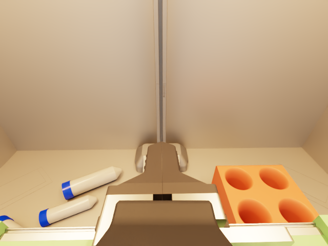
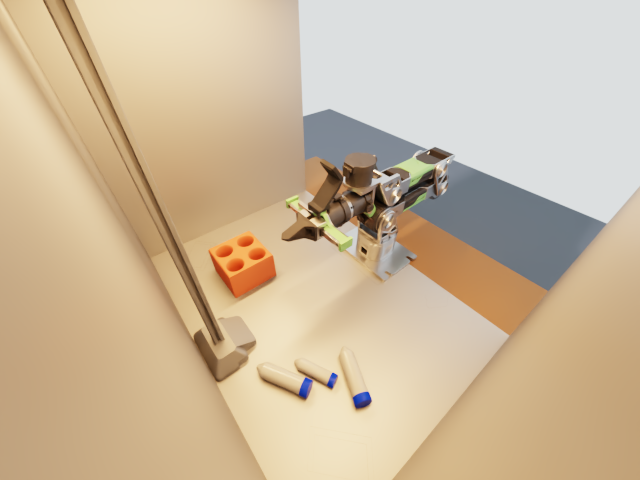
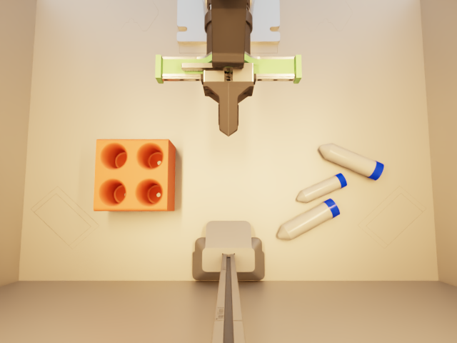
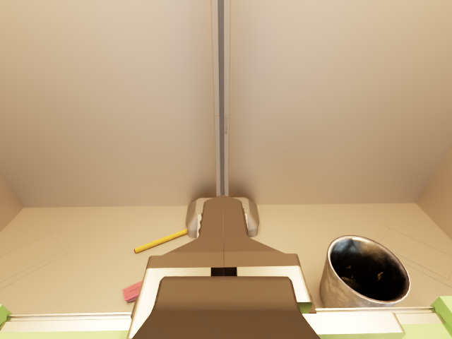
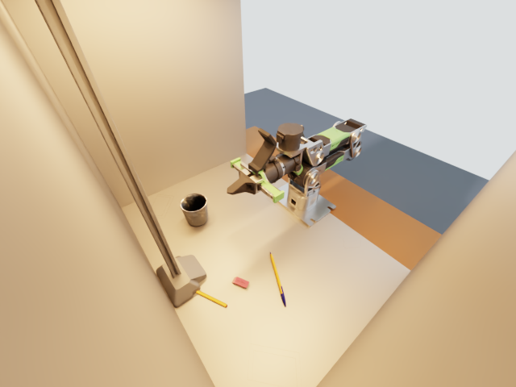
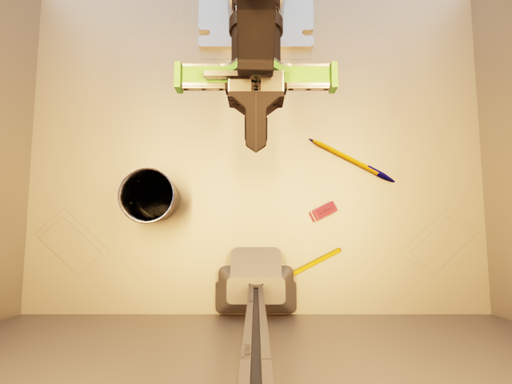
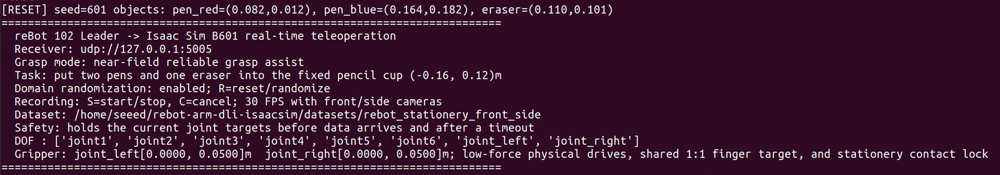
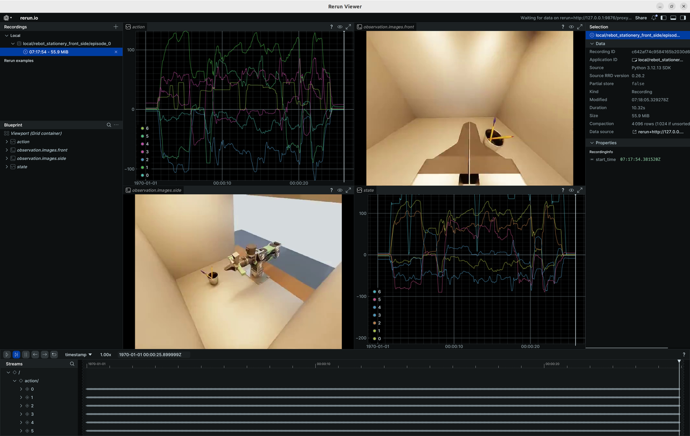

# Collect Data from Isaac Sim

This article describes how to use the reBot Arm 102 Leader to control the B601 robotic arm in Isaac Sim in real time, and collect human demonstrations of "placing the three vials into the vial rack" as a LeRobot Dataset v3 dataset.

> [!NOTE]
> This chapter is optional. It is recommended to run the complete real-world loop first (collect data → train → evaluate in the real environment, sections 3.1–3.3). Simulation data does not occupy the real robot and can scale scene and lighting diversity at low cost, so it works well as a supplement once the real pipeline is verified.


## Learning Objectives

- Learn about the Nvidia Isaac Sim simulation tool
- Learn the workspace camera layout: the wrist-mounted `front` camera, the fixed `side` camera, and the overhead `external` camera
- Generate a complete `VLA` training dataset

## Data Acquisition Process

The data link of this project is as follows:

```text
reBot Arm 102 Leader
       | USB-UART
       ▼
LeRobot Python bridge -- UDP 127.0.0.1:5005 --> Isaac Sim B601
                                                        |
                                   +--------------------+--------------------+
                                   |                    |                    |
                                   ▼                    ▼                    ▼
                              action/state         front camera        external camera
                                   |                    |                    |
                                   +--------------------+--------------------+
                                                        |
                                                        ▼
                                                 LeRobot Dataset v3
```

The `Leader` only provides manual control commands, and the simulated robotic arm will not autonomously execute the grasping trajectory. The system simultaneously records:

- `action`: 6 arm joint and gripper commands for the `Leader`;
- `observation.state`: the states of the 6 joints and the gripper of simulation B601;
- `observation.images.front`: camera images that move along with the wrist;
- `observation.images.external`: the overhead view from the data-collection camera above the workspace;
- Task text (`Put the three vials into the vial rack`), randomization parameters, and task success status.

The default acquisition frequency is 30 `FPS`. Both recorded cameras have a resolution of 640 × 480. The GUI also opens a fixed `side` camera viewport inside the enclosure; it is for observation only and is not written to the dataset.

## Camera Views

After pressing `R` to reset the scene, the three camera views look like this. `front` and `external` are the two video streams actually recorded into the dataset:

<div style="display: grid; grid-template-columns: repeat(auto-fit, minmax(240px, 1fr)); gap: 1.25rem; margin: 1.5rem 0;">
  <figure style="margin: 0;">
    
    <figcaption style="text-align: center; font-size: 0.875rem; margin-top: 0.5rem;">front (wrist-mounted, moves with the arm)</figcaption>
  </figure>
  <figure style="margin: 0;">
    
    <figcaption style="text-align: center; font-size: 0.875rem; margin-top: 0.5rem;">side (fixed inside the enclosure, observation only)</figcaption>
  </figure>
  <figure style="margin: 0;">
    
    <figcaption style="text-align: center; font-size: 0.875rem; margin-top: 0.5rem;">external (overhead, recorded)</figcaption>
  </figure>
</div>

> [!NOTE]
> The hardware visible in the lower part of the `front` view (gripper and camera mount) is expected — the wrist camera sits at the front of the lens and looks along the arm. Use `./run.sh --single-viewport` to keep only the main viewport and hide the three floating camera windows; recording is unaffected.

## Optional Task: Pens and Eraser into the Pencil Cup

Besides the default vial task, the project ships an optional `stationery` scene: a fixed pencil cup at `(-0.16, 0.12) m` with two pens and an eraser as the graspable objects. The robot, enclosure and all three cameras are identical to the default scene, and the scene file is generated automatically on first launch:

```bash
./run.sh --variant stationery
```

After pressing `R`, the three camera views look like this (`front` and `external` are the recorded streams):

<div style="display: grid; grid-template-columns: repeat(auto-fit, minmax(240px, 1fr)); gap: 1.25rem; margin: 1.5rem 0;">
  <figure style="margin: 0;">
    
    <figcaption style="text-align: center; font-size: 0.875rem; margin-top: 0.5rem;">front (wrist-mounted, recorded)</figcaption>
  </figure>
  <figure style="margin: 0;">
    
    <figcaption style="text-align: center; font-size: 0.875rem; margin-top: 0.5rem;">side (fixed, observation only)</figcaption>
  </figure>
  <figure style="margin: 0;">
    
    <figcaption style="text-align: center; font-size: 0.875rem; margin-top: 0.5rem;">external (overhead, recorded)</figcaption>
  </figure>
</div>

The capture flow is the same (`R` reset / `S` record / `C` cancel), and the episode succeeds once all three items rest stably inside the cup. Data is written to a separate dataset so it never mixes with the default vial data:

```bash
~/rebot-arm-dli-isaacsim/datasets/rebot_stationery_pencil_cup
# Task text: Put the two pens and the eraser into the pencil cup
```

> [!NOTE]
> The stills above are rendered with Path Tracing via the project's headless capture script. The real-time GUI viewport may still look noisy on 8 GB GPUs whose DLSS Ray Reconstruction is unavailable (see the project tutorial, "Known Issues").

## Environmental Requirements

Please confirm the following before starting:

- Ubuntu 22.04;
- NVIDIA RTX GPU with **at least 12 GB of VRAM**, and Isaac Sim 6.1 installed and launchable;
- Isaac Sim is installed by default at `~/isaacsim`;
- The LeRobot environment is located at `~/rebot_lerobot/.venv` and was installed with the dataset extras (see section 3.1): `uv pip install -e "./lerobot[dataset,viz]"`. Without them, the recorded episodes fail to convert (the terminal prints `[dataset-error]`) and the dataset visualizer is unavailable;
- The reBot Arm 102 Leader has been connected to the computer via USB-UART and calibrated successfully;
- `git-lfs` is installed (the project's USD assets are stored with Git LFS).

> [!WARNING]
> Use an RTX GPU with at least 12 GB of VRAM. On 8 GB GPUs (e.g. most laptop GPUs) the render load can starve the desktop compositor and freeze the whole machine within minutes, even with the built-in mitigations enabled. See the project tutorial `TUTORIAL_zh.md` (sections 1 and 10) for details and partial mitigations.

The recommended directory structure is as follows:

```text
~
├── isaacsim/
└── rebot_lerobot/
    └── .venv/bin/python
```

## Download Source Code

Run the following command in the terminal of the Ubuntu host:

```bash
sudo apt update
sudo apt install -y git-lfs

cd ~
git clone https://github.com/Seeed-Projects/rebot-arm-dli-isaacsim.git
cd rebot-arm-dli-isaacsim
git lfs install
git lfs pull
```

> [!WARNING]
> The robot, camera-mount, workspace, vial and rack assets are stored with Git LFS. Without `git lfs pull` the clone only contains small pointer files, and Isaac Sim cannot open the scene.

## Launch Isaac Sim Teleoperation

Navigate to the project directory and start:

```bash
cd ~/rebot-arm-dli-isaacsim
./run.sh --leader-port /dev/ttyUSB0
```

If there is only one `/dev/ttyUSB*` device, you can also let the program detect it automatically:

```bash
./run.sh
```

If Isaac Sim is installed in a different directory:

```bash
ISAACSIM_ROOT=/path/to/isaacsim ./run.sh --leader-port /dev/ttyUSB0
```

The first launch takes a few minutes to compile shaders; this is normal. After startup is complete, the terminal shall display:



## Capture an episode

Ensure that the Isaac Sim viewport has obtained keyboard focus, then performs the following operations in sequence:

1. Press `R` to reset the scene. The three vials will be repositioned, and randomization of objects and lighting will be applied.
2. Check the three camera views (see above) and the initial position of the vials.
3. Press `S` to start recording. The following should appear on the terminal:

```text
[record] Episode started at 30 FPS -> .../datasets/rebot_stationery_front_side
```

4. Operate the leader, and put the three vials into the vial rack in sequence (any of the four slots works).
5. Release the gripper and wait for the vials to stabilize in the rack.
6. When `[SUCCESS]` appears on the terminal, press `S` to finish and save the episode.
7. Wait for the background encoding to complete until the following message appears in the terminal:

```text
[dataset] Episode saved; total completed: 1
```

The system will convert temporary JPEGs, actions and states into LeRobot Dataset v3 in the background, and you can start the next operation during the encoding process. When exiting the program, if there are still pending episodes, the program will wait for the background tasks to complete.

## Keyboard Shortcuts

| button | Function |
|---|---|
| `R` | Reset the three vials and re-randomize them |
| `S` | Start recording; press again while recording to end and save |
| `C` | Cancel the current episode without writing it to the dataset |

If a vial falls, a grasp fails, the motion quality is poor, or the camera is occluded during the demonstration, press `C` to discard the current episode, then press `R` to start the next data collection.

The default output directory for collected data is:

```bash
~/rebot-arm-dli-isaacsim/datasets/rebot_stationery_front_side
```

> [!NOTE]
> To train GR00T 1.7 on this simulated dataset (section 3.2), change `video.side.original_key` in `modality.json` from `observation.images.side` to `observation.images.external` (the real dataset from section 3.1 keeps using `side`).

## Inspect and visualize datasets

You can quickly inspect the collected data using the LeRobot visualization tool by running the following command in the terminal:

```bash
cd ~/rebot_lerobot
source .venv/bin/activate

lerobot-dataset-viz \
    --repo-id local/rebot_stationery_front_side \
    --root ~/rebot-arm-dli-isaacsim/datasets/rebot_stationery_front_side \
    --mode local \
    --episode-index 0 \
    --display-compressed-images false
```

Check different episodes in sequence to confirm that the actions, statuses and the time of the two video streams are synchronized, and there are no black frames, frozen frames or severe occlusion in the picture.



## Replaying Actions in Isaac Sim

First, start an Isaac Sim receiver that does not connect to the Leader, does not record data, and has randomization disabled:

```bash
cd ~/rebot-arm-dli-isaacsim
./run.sh --no-start-bridge --no-recording --no-dr
```

Then open the second terminal and play back the 0th episode:

```bash
cd ~/rebot-arm-dli-isaacsim
../rebot_lerobot/.venv/bin/python \
    scripts/replay_episode.py --episode 0
```

Loop playback can be enabled by adding `--loop`:

```bash
../rebot_lerobot/.venv/bin/python \
    scripts/replay_episode.py --episode 0 --loop
```

The replay script sends the data in the dataset `action`, which is used to check the motion trajectory of the robotic arm; it is not a dual-camera video player, and the camera content should be inspected using the LeRobot dataset visualization tool.

## Verify without the Leader (optional)

If the Leader arm is not available yet, the whole pipeline can still be validated with the built-in mock leader:

```bash
cd ~/rebot-arm-dli-isaacsim
./run.sh --test                     # physics and grasp regression, ~3 minutes
./run.sh --test --test-recording    # additionally validates the cameras and dataset writing
```

The final `[SUCCESS]` means: all USD assets load, the scene builds, physics/gripper/grasping work, and the dataset is written correctly. No hardware is required.

## Configuration and Reference Materials

Main configuration files in the project:

- `config/teleop_config.json`: serial port, UDP, joint mapping and grasping assistance;
- `config/domain_randomization.json`: object, lighting, camera and dataset parameters;
- `config/grasp_config.json`: scene objects, physical parameters and task success conditions;
- `scripts/capture_camera_previews.py`: headless script that rewrites the camera stills used in this chapter.
